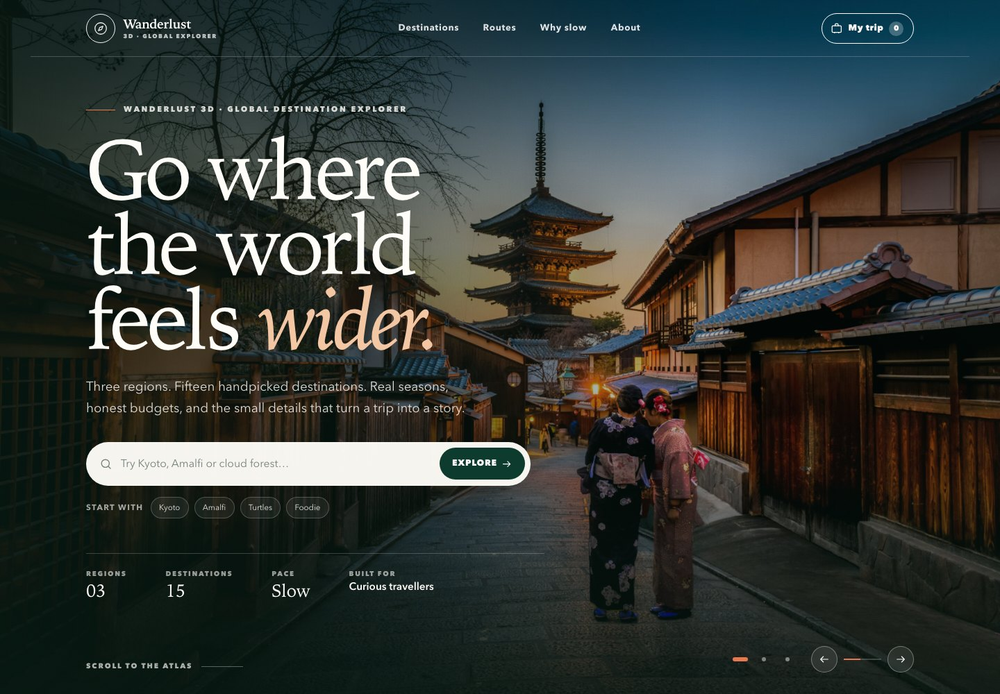
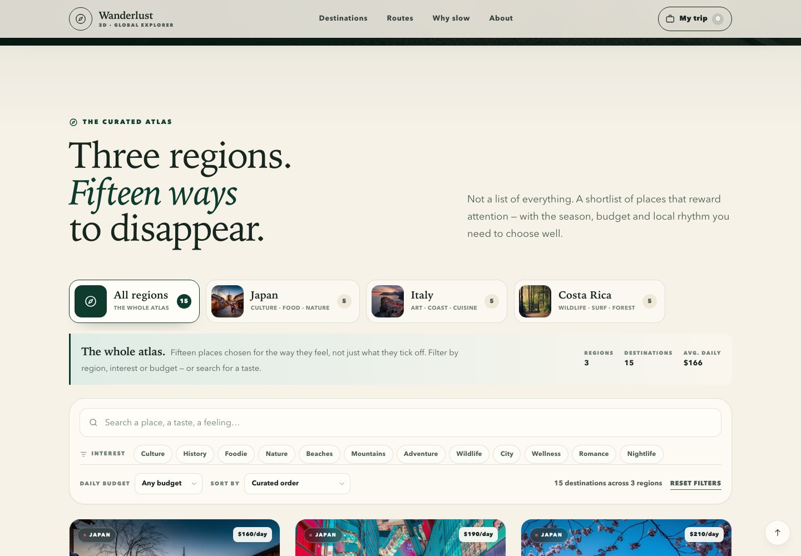
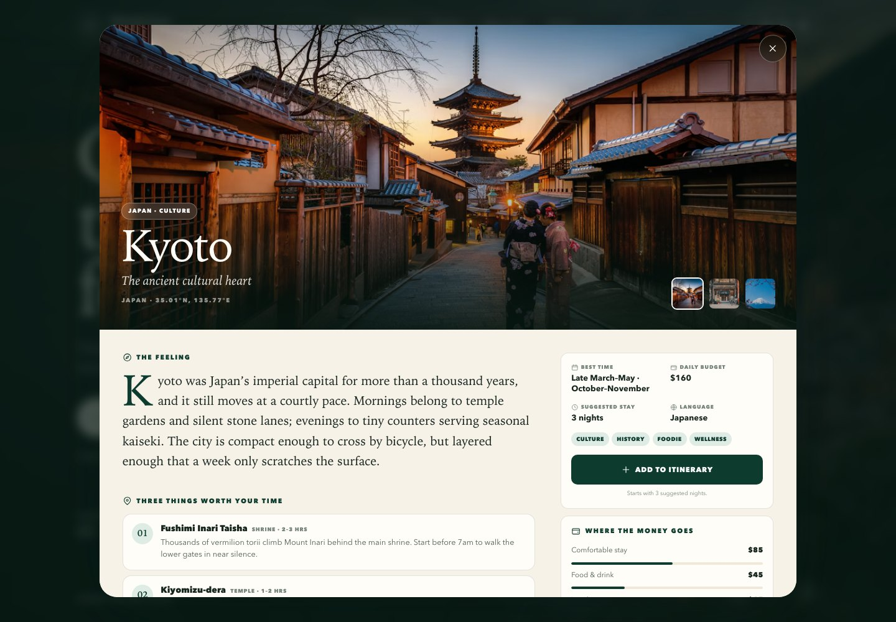
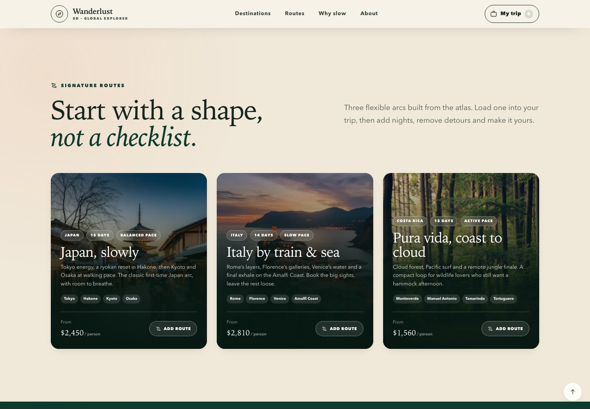
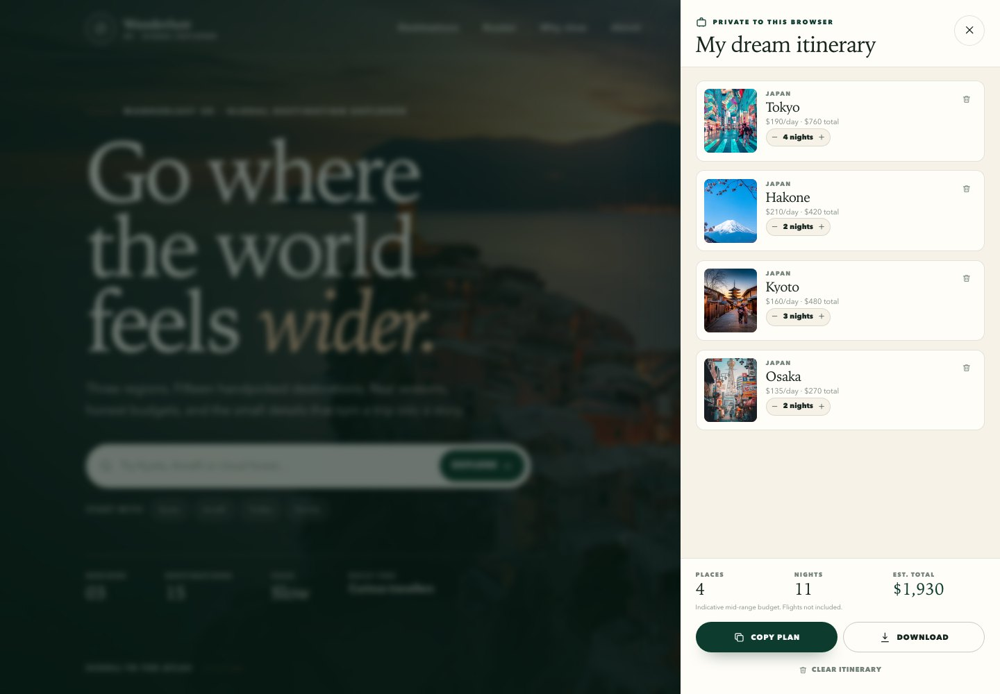
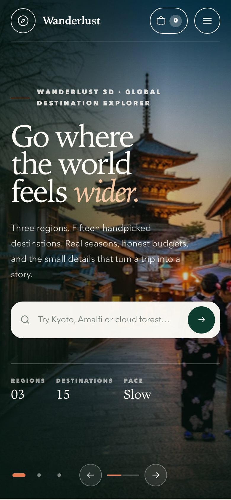
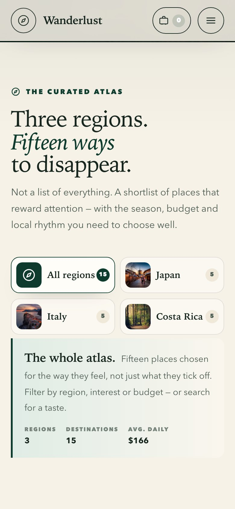
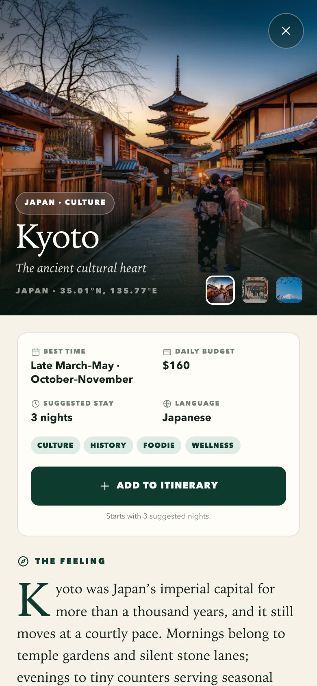

# Wanderlust 3D — Global Destination Explorer

**Three regions. Fifteen handpicked destinations. One dream itinerary.**

A photography-led travel atlas for Japan, Italy and Costa Rica. Built as a static, zero-build web
application with vanilla HTML5, CSS3 and ES6. Browse by region, search by feeling, open a full
destination guide, and keep a persistent trip shortlist in your browser.

[](https://somphol.github.io/wanderlust-3d/)
[](#verification)
[](#quick-start)
[](LICENSE)



## What it is

Wanderlust 3D is a small, independent travel atlas — not a booking engine and not a list of
everything. It covers **3 regions × 5 destinations = 15 curated places**, each with:

- editorial overview and a distinct point of view
- verified Unsplash photography and a three-image gallery
- best travel window, shoulder season and weather notes
- indicative daily budget broken into stay, food, transport and activities
- three must-see attractions, four local dishes, cultural notes and an itinerary tip
- interest tags, suggested nights and a budget tier

The interface adds a full-screen hero slider, live region/interest/budget filtering, destination
modals with deep links, three signature routes, and a persistent **My Dream Itinerary** drawer with
night steppers, estimated totals, copy and download.

## The atlas

| Region | Destinations |
| --- | --- |
| **Japan** | Kyoto · Tokyo · Hakone · Osaka · Okinawa |
| **Italy** | Rome · Florence · Venice · Amalfi Coast · Dolomites |
| **Costa Rica** | Monteverde · Manuel Antonio · Tamarindo · Tortuguero · Corcovado & Drake Bay |

## Highlights

- **Photography first.** 24 unique, individually verified Unsplash images with `srcset`, lazy
  loading, fixed aspect ratios and graceful CDN fallbacks.
- **Live search and filters.** Search across names, regions, attractions, cuisines and interests;
  combine region tabs, multi-select interest chips, budget tiers and four sort orders.
- **Immersive destination modal.** Gallery thumbnails, a budget breakdown, a 12-month best-time
  strip, cultural notes and keyboard/previous-next navigation.
- **Persistent trip planner.** `localStorage` keeps places and night counts across reloads. Add a
  whole signature route in one click; copy or download the itinerary as text.
- **Deep links.** Every destination has a shareable URL such as
  `https://somphol.github.io/wanderlust-3d/#/destination/kyoto`.
- **Responsive by design.** A three-column editorial desktop, a two-column tablet, and a one-column
  mobile layout tested at 390 px with no horizontal overflow.
- **Accessible defaults.** Skip link, semantic landmarks, focus traps, focus restoration, `aria-live`
  result counts, keyboard tabs, reduced-motion support and visible focus rings.
- **Zero runtime build.** Open `index.html` or serve the folder. No bundler, no framework, no
  package install required to view the site.
- **Release discipline.** 81 automated browser checks, a separate image-reachability audit,
  reproducible screenshots, GitHub Pages deployment and a full handoff.

## Screenshots

| Explorer | Destination modal |
| --- | --- |
|  |  |

| Signature routes | Dream itinerary |
| --- | --- |
|  |  |

| Mobile hero | Mobile explorer | Mobile destination |
| --- | --- | --- |
|  |  |  |

The 1200 × 630 social card lives at `screenshots/og-cover.jpg` and is referenced by the Open Graph
and Twitter meta tags.

## Quick start

No build step is required. Serve the directory over HTTP so `localStorage` and relative links behave
exactly as they do in production:

```sh
# Option A — any static server
python3 -m http.server 8080

# Option B — the included Node helper (Node 20+)
npm run serve
```

Open <http://localhost:8080>. Every app file is static.

To use your own port:

```sh
PORT=9000 npm run serve
```

## Verification

The release gate uses the locally installed Chrome through `puppeteer-core` (a dev dependency only;
the app itself ships nothing from `node_modules`).

```sh
npm install          # installs puppeteer-core for the checks
npm run verify       # 81 headless UI/data/responsive/accessibility checks
npm run verify:images # HEADs every unique Unsplash image (network required)
npm run screenshots  # regenerates screenshots/ from the running app
```

Expected output ends with:

```text
80+ checks passed
Release checks passed.
All image URLs resolved.
```

Set `CHROME_PATH` if Chrome is not in a standard location:

```sh
CHROME_PATH=/path/to/chrome npm run verify
```

See [docs/VERIFICATION.md](docs/VERIFICATION.md) for what is covered and the manual QA checklist.

## Project structure

```text
wanderlust-3d/
├── index.html               # semantic shell, SVG icon sprite, hero, sections, overlays
├── style.css                # design tokens + all component and responsive styles
├── data.js                  # 3 regions, 15 destinations, 3 routes
├── script.js                # rendering, filters, modal, trip planner, slider
├── 404.html                 # branded static not-found page
├── manifest.webmanifest     # install metadata
├── robots.txt / sitemap.xml
├── assets/icon.svg          # compass app icon
├── screenshots/             # README and Open Graph images
├── docs/                    # architecture, data, design, verification, deployment, reproduction
├── scripts/
│   ├── serve.mjs            # tiny static server
│   ├── verify.mjs           # 81-check headless release gate
│   ├── check-images.mjs     # Unsplash reachability audit
│   ├── screenshots.mjs      # reproducible README captures
│   └── lib/static-server.mjs
├── .github/workflows/pages.yml
├── AGENTS.md                # one-minute handoff for future agents
├── state.json / STATE.md    # build time, tokens and provenance snapshot
└── package.json             # dev tooling only; no runtime dependencies
```

## Content model

All content is data. `data.js` exports a frozen `window.WANDERLUST_DATA` object; `script.js` never
hard-codes destination copy. Add or edit a destination in one place and the cards, filters, modal,
search and trip totals update automatically.

```js
{
  id: 'kyoto',
  regionId: 'japan',
  name: 'Kyoto',
  tagline: 'The ancient cultural heart',
  image: 'https://images.unsplash.com/photo-…',
  gallery: [{ image, alt }, …],
  bestTime: 'Late March–May · October–November',
  bestMonths: ['Mar', 'Apr', 'May', 'Oct', 'Nov'],
  dailyBudget: 160,
  budgetBreakdown: { stay: 85, food: 45, transport: 15, activities: 15 },
  vibes: ['Culture', 'History', 'Foodie', 'Wellness'],
  idealNights: 3,
  // overview, attractions, cuisine, culture, seasonNote, itineraryTip…
}
```

Rules enforced by the checks: unique IDs, exactly five destinations per region, three gallery
images, and a budget breakdown that sums to `dailyBudget`.

Read [docs/DATA-SCHEMA.md](docs/DATA-SCHEMA.md) before editing content.

## Deployment

GitHub Pages is wired through `.github/workflows/pages.yml`. Push to `main`, then set
**Settings → Pages → Source** to **GitHub Actions** once. Every later push deploys automatically.

The static folder can also be hosted on Netlify, Cloudflare Pages, Vercel or any web server — there
is no server-side code and no build command.

See [docs/DEPLOYMENT.md](docs/DEPLOYMENT.md) for the first-run setup, cache notes and rollback.

## Documentation

- [AGENTS.md](AGENTS.md) — the one-minute handoff: commands, architecture, constraints, continuity
- [docs/ARCHITECTURE.md](docs/ARCHITECTURE.md) — rendering flow, state, filters, modal, accessibility
- [docs/DATA-SCHEMA.md](docs/DATA-SCHEMA.md) — every field, image rules, content standards
- [docs/DESIGN-SYSTEM.md](docs/DESIGN-SYSTEM.md) — palette, type scale, components, motion
- [docs/VERIFICATION.md](docs/VERIFICATION.md) — automated layers, manual checklist, expected output
- [docs/DEPLOYMENT.md](docs/DEPLOYMENT.md) — GitHub Pages, local serving, rollback, custom domains
- [docs/REPRODUCTION.md](docs/REPRODUCTION.md) — how this build was made, prompt, decisions, token state
- [CONTRIBUTING.md](CONTRIBUTING.md) — content and code standards
- [CREDITS.md](CREDITS.md) — photography and tooling credits

## Stack and constraints

- HTML5, CSS3, ES6 — no framework, no runtime build
- Tailwind Play CDN is included because the original brief asked for Tailwind via CDN. The interface
  is authored in `style.css` with CSS custom properties and remains fully styled if the CDN is
  blocked. See the known limit below.
- Unsplash CDN for photography; system fonts for zero font requests
- `localStorage` for the trip planner only; no accounts, analytics or tracking
- GitHub Pages for hosting

## Known limits

- The Tailwind Play CDN prints a development-only console warning. It is not used for layout;
  removing the two `<script>` tags in `index.html` removes the warning without changing the design.
- Photography is hotlinked from Unsplash, so the first view needs a network connection. The layout
  degrades to gradient placeholders if an image fails.
- Budgets, seasons and opening details are editorial planning notes, not live prices. Confirm with
  official sources before booking.
- The trip planner is per browser/profile. Clearing site data clears the itinerary.
- There is no booking, payment, account or server-side synchronization.

## Credits

Designed and built with **OpenCode** and **DeepSeek V4.1 Flash** in a single session on 6 November
2026. Photography by Unsplash contributors under the Unsplash License. Full attribution and image
inventory in [CREDITS.md](CREDITS.md).

## License

Code and original editorial copy: [MIT](LICENSE). Photography: [Unsplash
License](https://unsplash.com/license) — free to use, no attribution required. Destination names and
factual details belong to their respective places; travel notes are provided for planning inspiration.
